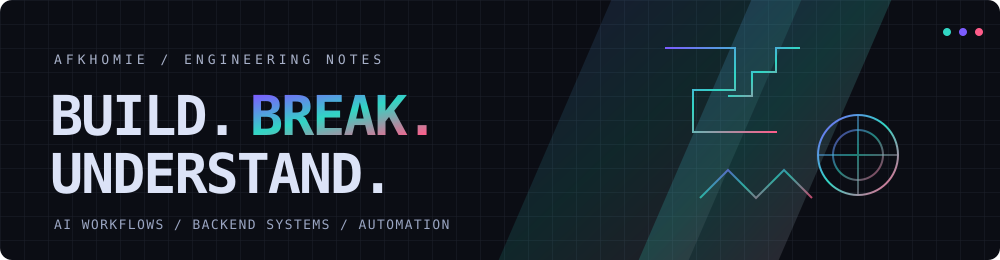

 

**I build software, tools, and systems that start with a question and end with a working thing.**

[GitHub](https://github.com/Afkhomie) · [Projects](https://github.com/Afkhomie?tab=repositories)

---

### `/about`

- Exploring **AI-assisted engineering, multi-agent workflows, and automation**.
- Most interested in backend logic, debugging, system behavior, and making separate parts work together.
- Co-founder at **SajhaStack**, working around developer communities and hackathons.
- I use AI to accelerate implementation, not outsource judgment. Generated code still has to earn its place.
- Occasionally making beats and experimenting with sound design. A side quest, not the entire plot.

### `/selected-work`

A few things worth opening:

- **[Engine Audio Sim](https://github.com/Afkhomie/engine-audio-sim)**  
  Browser-based engine and drivetrain simulation with real-time audio, gears, clutch behavior, and the Web Audio API.

- **[Engine Simulator](https://github.com/Afkhomie/Engine_Simulator-Unfinished-)**  
  Python GUI and C++ experiments around engine behavior, drivetrain simulation, and synthesized audio.

- **[NodeFlow](https://github.com/Afkhomie/NodeFlow)**  
  A Windows system application built with Python, PyQt6, and optional native C++.

- **[YTMusicAuto](https://github.com/Afkhomie/YTMusicAuto)**  
  A small automation tool for handling a repetitive YouTube Music interaction.

- **[AFK Polybar](https://github.com/Afkhomie/afk_polybar)**  
  A minimal Linux status bar with system monitoring, controls, and a Catppuccin Mocha theme.

### `/toolbox`

**Languages**  

**Frameworks and platforms**  

**Workflow**  
AI-assisted development · CLI tooling · debugging · automation · backend engineering

### `/activity`

Stats are generated from public GitHub data by external services. Language cards describe repository contents, not a ranking of personal skill.

---

**Curiosity → experiments → working systems.**

Some projects ship. Others teach me exactly what not to do next time.

